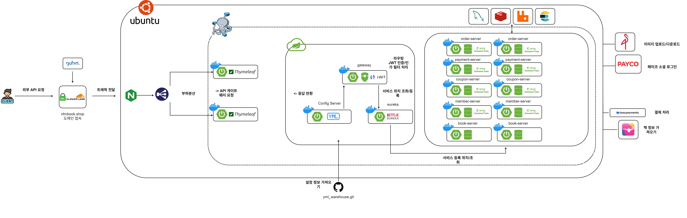
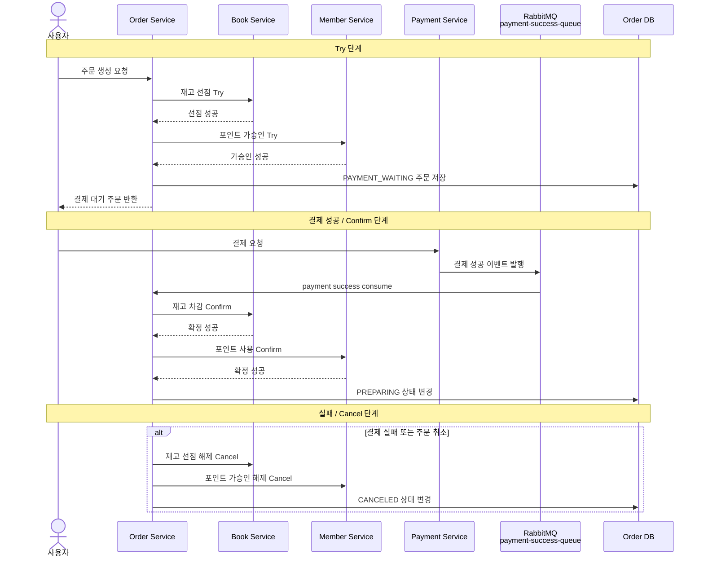
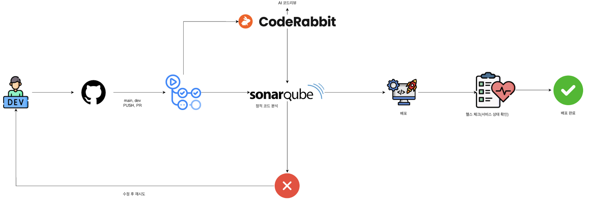

# HighFiveBooks V2

> 주문 정합성, 메시지 장애 격리, 대용량 조회 성능을 개선한 온라인 서점 MSA입니다.


## 💻 Tech Stacks

| 구분 | 기술 |
| --- | --- |
| Backend | Java 21, Spring Boot 3.5.7, Spring Data JPA, Spring Cloud Gateway, Eureka, Config Server, OpenFeign, Resilience4j |
| Frontend | Thymeleaf, React, TypeScript, Vite |
| Data | MySQL 8.4, Redis 7.2, Elasticsearch 8.18 + Nori, MinIO |
| Messaging | RabbitMQ, Retry/DLQ, idempotency key |
| Infrastructure | Ubuntu, Docker, Docker Compose, Nginx, HAProxy, Cloudflare |
| CI/CD | GitHub Actions, CodeRabbit, SonarQube, Docker health check |
| Test | JUnit 5, Mockito, Spring Boot Test, k6 |

## 🏗️ System Architecture



Cloudflare와 Nginx·HAProxy가 외부 트래픽을 전달하고, Gateway가 인증·인가와 도메인 라우팅을 담당합니다. Eureka는 서비스 위치를 제공하고 Config Server는 공통 설정을 관리합니다. V2에서도 주문·도서·회원·쿠폰·결제 서비스의 독립 경계는 유지했습니다.

### 주문/TCC 처리 흐름



이 흐름은 포트폴리오의 **HighFiveBooks 주문 도메인/TCC 다이어그램**과 동일한 참여자와 단계로 정리했습니다. 쿠폰 계산·사용은 실제 주문 기능에 포함되지만, 다이어그램에서는 재고·포인트 TCC 경계를 명확히 보여주기 위해 생략했습니다.

## 🚀 CI/CD Pipeline



- Push와 Pull Request를 기준으로 자동 검증을 시작합니다.
- CodeRabbit 리뷰와 SonarQube 정적 분석 결과를 확인한 뒤 배포합니다.
- 배포 후 서비스 health check를 수행하고, 실패하면 수정 후 파이프라인을 다시 실행합니다.

## ✨ 주요 기능 (Key Features)

| 영역 | 주요 기능 |
| --- | --- |
| 도서 탐색 | 목록·상세 조회, 카테고리 탐색, Elasticsearch Nori 검색, 리뷰·좋아요, Aladin 도서 수집 |
| 회원 | 회원가입·로그인, 소셜 로그인, 배송지, 장바구니, 포인트, 회원 등급 |
| 쿠폰 | 쿠폰 발급·계산·사용·취소 |
| 주문 | 주문 생성·조회, 포장·배송 정책, 주문 취소·반품, 최근 주문 조회 |
| 결제 | Toss Payments 승인·취소, 결제 성공 이벤트 발행 |
| 분산 정합성 | 재고 `hold/confirm/release`, 포인트 `reserve/confirm/cancel`, 중복 요청 방지 |
| 장애 격리 | RabbitMQ Retry/DLQ, Feign timeout·CircuitBreaker, 상태 변경 호출의 자동 retry 차단 |

## 🔎 Design Highlights

### TCC 기반 주문 정합성과 멱등성

- **문제 상황**: 서비스별 DB를 사용해 재고·포인트·결제를 하나의 로컬 트랜잭션으로 묶을 수 없었고, 실패나 중복 요청이 부분 반영과 이중 처리를 만들 수 있었습니다.
- **의사 결정**: 이벤트 순서와 보상 이벤트까지 관리해야 하는 Saga보다, 선점 가능한 재고·포인트의 Try·Confirm·Cancel을 코드에서 명확히 확인할 수 있는 TCC를 선택했습니다.
- **해결**: 재고 선점과 포인트 가승인 후 결제 결과에 따라 확정 또는 반환하고, 주문 상태와 도메인별 idempotency key로 중복 Confirm·Cancel을 차단했습니다.
- **검증 결과**: 중복 Confirm·Cancel, 포인트 반환 실패, 재고 반환 지연, 결제 취소 지연 경로를 테스트했습니다.
- **한계**: 보상 완료 단계를 별도로 영속화하지 않아 프로세스 종료 이후의 durable retry는 지원하지 않습니다.

### 반복 실패 메시지 Retry/DLQ 격리

- **문제 상황**: 금액 불일치나 주문 후처리 실패 메시지가 반복 소비되면 정상 메시지 처리까지 방해할 수 있었습니다.
- **의사 결정**: 상태 변경 Feign 호출의 자동 retry는 끄고, 다시 처리할 수 있는 결제 성공 메시지에만 제한된 retry와 DLQ를 적용했습니다.
- **해결**: Listener 예외를 컨테이너로 전달하고 최대 3회 재시도한 뒤 `RejectAndDontRequeueRecoverer`와 Dead Letter Exchange로 격리했습니다.
- **검증 결과**: 큐·Exchange·DLQ·Binding과 retry/backoff 설정을 테스트하고, 로컬 RabbitMQ에서 payload와 `x-death` 헤더가 유지된 DLQ 이동을 확인했습니다.
- **한계**: 실브로커 통합 테스트는 RabbitMQ가 제공되는 환경에서만 조건부로 실행됩니다.

### JPA Collection Fetch와 Pageable 병목 개선

- **문제 상황**: 도서 157,118건에서 collection `EntityGraph`와 `Pageable`을 함께 사용하자 Hibernate가 연관 결과를 메모리에 올린 뒤 pagination을 수행해 목록 p95가 9,039.51ms까지 증가했습니다.
- **의사 결정**: API 응답을 바꾸지 않으면서 목록과 상세의 조회 목적에 따라 Fetch Graph를 분리했습니다.
- **해결**: 목록에서는 `publisher`만 즉시 로딩하고, `bookAuthors.author`는 상세 조회에서만 불러오도록 변경했습니다.
- **검증 결과**: 동일 k6 시나리오의 저장 결과에서 목록 p95가 9,039.51ms에서 51.97ms로 개선됐습니다.
- **한계**: 30초 전후 1회 측정이며 요청 수가 달라 반복 실험 중앙값으로 표현하지 않습니다.

## 🧪 Validation Status

| 항목 | 상태 |
| --- | --- |
| order-server | 132 tests, 0 failures, 0 errors, 1 skipped |
| book-server | 346 tests, 0 failures, 0 errors, 0 skipped |
| TCC 멱등·보상 | 중복 Confirm/Cancel과 실패·timeout 단위 테스트 통과 |
| RabbitMQ Retry/DLQ | 설정·Listener 테스트 통과, 실브로커 통합 테스트는 환경에 따라 조건부 실행 |
| JPA 목록 조회 | p95 9,039.51ms → 51.97ms, HTTP 실패율 0% |

Windows의 비 ASCII 사용자 경로에서 JaCoCo agent가 JVM 시작에 실패할 수 있어 book-server 전체 테스트는 `-Djacoco.skip=true` 조건으로 확인했습니다.

## 🛠️ Local Development

```powershell
Copy-Item .env.example .env
docker compose up -d --build
docker compose ps
```

기본 포트는 다음과 같습니다.

| 서비스 | 포트 |
| --- | ---: |
| member-server | 9001 |
| book-server | 9002 |
| coupon-server | 9004 |
| payment-server | 9005 |
| order-server | 9006 |
| RabbitMQ Management | 15672 |

실제 DB 비밀번호, JWT Secret, 외부 API 자격증명은 `.env` 또는 배포 환경에만 설정합니다.

## 📁 Repository Structure

```text
HighFivebooks-V2/
├─ apps/storefront/          # React 사용자 쇼핑몰 프론트
├─ services/
│  ├─ order-server/         # 주문 조율, TCC, 결제 이벤트 처리
│  ├─ book-server/          # 도서, 검색, 재고
│  ├─ member-server/        # 회원, 포인트, 장바구니
│  ├─ coupon-server/        # 쿠폰 계산, 사용, 취소
│  └─ payment-server/       # 결제 승인, 취소, 이벤트 발행
├─ perf/                    # k6 시나리오와 결과
├─ scripts/                 # 실행·검증 스크립트
├─ docs/                    # 설계와 트러블슈팅 근거
└─ docker-compose.yml
```
