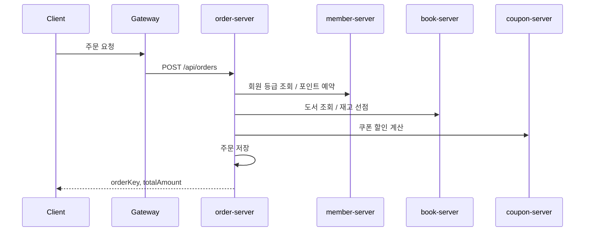
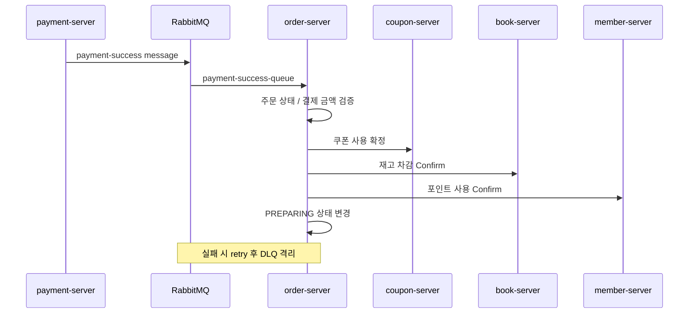

<div align="center">

# HighFiveBooks V2

**주문 정합성, 메시지 장애 격리, 대용량 조회 성능을 개선한 온라인 서점 MSA**


</div>

---

## 프로젝트 소개

HighFiveBooks는 도서 탐색부터 장바구니, 주문, 결제, 쿠폰, 포인트, 배송까지 제공하는 온라인 서점입니다. 도서·회원·쿠폰·결제·주문을 독립 서비스로 구성하고 Spring Cloud Gateway, Eureka, Config Server를 통해 연결한 MSA 팀 프로젝트를 기반으로 합니다.

개인 V2 리팩토링에서는 기능 확장보다 `order-server`를 중심으로 다음 문제를 재현하고 개선했습니다.

- 결제 실패와 중복 요청에서 재고·포인트가 이중 반영되는 문제
- 결제 성공 poison message가 반복 소비되는 문제
- 실제 규모 데이터에서 JPA collection fetch와 pagination이 충돌하는 문제
- 외부 상태 변경 호출의 timeout과 암묵적 retry 경계

> 이 저장소는 리팩토링 관리를 위해 monorepo로 정리했지만, 각 도메인 서비스의 독립 실행·배포 경계는 유지합니다.

## 핵심 문제 해결

### 1. TCC 기반 주문 정합성과 멱등성

주문·도서·회원·결제 서비스가 서로 다른 DB를 사용하므로 재고와 포인트 변경을 하나의 로컬 트랜잭션으로 묶을 수 없었습니다.

- Try에서 재고를 선점하고 포인트를 예약
- 결제 성공 시 재고·포인트 Confirm
- 주문 저장 또는 결제 실패 시 Cancel 보상
- 주문 상태와 도메인별 idempotency key로 중복 Confirm/Cancel 차단
- 포인트 Cancel 실패, 재고 release timeout, 결제 Cancel timeout 경로 테스트

중복 요청 테스트에서 외부 Confirm/Cancel과 재고 수량 변경이 한 번만 수행되는 것을 확인했습니다. 다만 보상 완료 단계를 별도로 영속화하는 durable retry는 후속 과제로 남아 있습니다.

### 2. RabbitMQ Retry/DLQ 장애 격리

결제 성공 메시지 처리 중 금액 불일치나 후처리 실패가 발생하면 같은 메시지가 정상 주문 처리까지 방해할 수 있었습니다.

- `payment-success-queue`에 Dead Letter Exchange와 routing key 연결
- listener 예외를 전파하고 최대 3회 retry
- 재시도 소진 후 `RejectAndDontRequeueRecoverer`로 전용 DLQ 격리
- 재고·포인트처럼 상태를 변경하는 Feign 호출은 기본 retry 비활성화
- 정상 메시지의 `PAYMENT_WAITING → PREPARING` 상태 전이 검증

수동 실브로커 검증에서 금액 불일치 메시지의 DLQ 이동을 확인했고, reject된 payload와 `x-death` header를 확인하는 조건부 통합 테스트를 추가했습니다.

### 3. JPA Collection Fetch와 Pageable 병목 개선

도서 157,118건 환경에서 목록 조회에 collection `EntityGraph(bookAuthors, bookAuthors.author)`와 `Pageable`을 함께 사용하자 Hibernate가 DB pagination 대신 연관 결과를 메모리에서 처리했습니다.

목록 조회는 `publisher`만 즉시 로딩하고 저자 collection은 상세 조회에서만 로딩하도록 fetch graph를 분리했습니다.

| 지표 | Before | After |
| --- | ---: | ---: |
| 목록 조회 p95 | 9,039.51ms | **51.97ms** |
| 목록 조회 평균 | 6,907.78ms | **44.17ms** |
| HTTP 실패율 | 0% | **0%** |

저장된 동일 k6 시나리오의 1회 전후 측정 기준으로 p95가 약 174배 개선됐습니다. 전후 요청 수와 짧은 측정 시간을 고려해 반복 실험의 중앙값으로 표현하지는 않습니다.

## 기술 스택

| 영역 | 기술 |
| --- | --- |
| Backend | Java 21, Spring Boot 3.5.7, Spring Data JPA, Spring Cloud Gateway, Eureka, Config Server, OpenFeign, Resilience4j |
| Frontend | Thymeleaf 기반 팀 프로젝트 프론트, React·TypeScript 기반 V2 storefront |
| Data | MySQL 8.4, Redis 7.2, Elasticsearch 8.18 + Nori, MinIO |
| Messaging | RabbitMQ, Retry/DLQ, idempotency key |
| Infrastructure | Ubuntu, Docker, Docker Compose, Nginx, HAProxy, Cloudflare |
| CI/CD | GitHub Actions, CodeRabbit, SonarQube, Docker health check |
| Test | JUnit 5, Mockito, Spring Boot Test, k6 |

## System Architecture

팀 프로젝트 당시 Spring Cloud 기반 MSA 운영 구성입니다. 외부 트래픽은 Cloudflare와 Nginx·HAProxy를 거쳐 프론트 서버로 전달되고, Gateway가 인증·인가와 도메인 서비스 라우팅을 담당합니다. Eureka는 서비스 위치를 제공하고 Config Server는 공통 설정을 관리합니다.

<p align="center">
  
</p>

V2 저장소에서는 주문·도서·회원·쿠폰·결제 서비스의 도메인 경계를 유지하면서 주문 정합성과 장애 대응 코드를 중심으로 리팩토링했습니다.

## CI/CD Pipeline

팀 프로젝트 당시 GitHub Actions 기반 CI/CD 흐름입니다. Push와 Pull Request를 기준으로 자동 검증을 시작하고 CodeRabbit 리뷰와 SonarQube 정적 분석 결과를 확인한 뒤 배포 및 서비스 health check를 수행하도록 구성했습니다. 검증 실패 시 수정 후 다시 시도하는 흐름으로 분리했습니다.

<p align="center">
  
</p>

## 주요 기능

| 도메인 | 주요 기능 |
| --- | --- |
| 도서 | 목록·상세 조회, 카테고리 검색, Elasticsearch Nori 검색, 리뷰·좋아요, Aladin 도서 수집 |
| 회원 | 회원가입·로그인, 소셜 로그인, 배송지, 장바구니, 포인트, 회원 등급 |
| 쿠폰 | 쿠폰 발급·계산·사용·취소, 메시지 소비 재시도와 DLQ |
| 주문 | 주문 생성·조회, 포장·배송 정책, 주문 취소·반품, 최근 주문 조회 |
| 결제 | Toss Payments 승인·취소, 결제 이벤트 발행과 실패 처리 |
| 분산 정합성 | 재고 `hold/confirm/restore`, 포인트 `reserve/confirm/cancel` 보상 흐름 |

## 주문 처리 흐름

### 주문 생성



### 결제 성공



## 검증

### order-server

```powershell
Set-Location services/order-server
.\mvnw.cmd test
```

```text
132 tests, 0 failures, 0 errors, 1 skipped
```

조건부 skip 1건은 실제 RabbitMQ가 있을 때 실행하는 DLQ 통합 테스트입니다.

### book-server

Windows의 비 ASCII 사용자 경로에서 JaCoCo agent가 JVM 시작에 실패할 수 있어 로컬 전체 테스트는 다음과 같이 실행했습니다.

```powershell
Set-Location services/book-server
.\mvnw.cmd '-Djacoco.skip=true' test
```

```text
346 tests, 0 failures, 0 errors, 0 skipped
```

### 성능 결과

- 실행 스크립트: `perf/k6/book-read-baseline.js`
- 원시 결과: `perf/results/book-read-baseline-20260708-234828.json`
- 개선 결과: `perf/results/book-read-optimized-20260708-235147.json`

## 로컬 실행

```powershell
Copy-Item .env.example .env
docker compose up -d --build
docker compose ps
```

기본 포트:

| 서비스 | 포트 |
| --- | ---: |
| member-server | 9001 |
| book-server | 9002 |
| coupon-server | 9004 |
| payment-server | 9005 |
| order-server | 9006 |
| RabbitMQ Management | 15672 |

## 저장소 구조

```text
HighFivebooks-V2/
├─ apps/storefront/          # React 사용자 쇼핑몰 프론트
├─ services/
│  ├─ order-server/         # 주문 조율, TCC, 결제 이벤트 처리
│  ├─ book-server/          # 도서, 검색, 재고
│  ├─ member-server/        # 회원, 포인트, 장바구니
│  ├─ coupon-server/        # 쿠폰 계산, 사용, 취소
│  └─ payment-server/       # 결제 승인, 취소, 이벤트 발행
├─ perf/                    # k6 시나리오와 결과
├─ scripts/                 # 실행·검증 스크립트
├─ docs/                    # 설계와 트러블슈팅 근거
└─ docker-compose.yml
```

## 문서

- [JPA 성능 보고서](docs/PERFORMANCE_REPORT.md)
- [TCC Failure Matrix](docs/TCC_FAILURE_MATRIX.md)
- [주문 흐름 경계](docs/order-flow-boundary-map.md)
- [주문 안정성 근거](docs/order-resilience-evidence.md)
- [성능·부하 테스트 기록](docs/PERFORMANCE_TEST_PROGRESS_2026-07-09.md)
- [로컬 재현 가이드](docs/LOCAL_REPRODUCIBILITY.md)

## Repository

- V2 리팩토링: [Sungw0o/HighFivebooks-V2](https://github.com/Sungw0o/HighFivebooks-V2)
- 기존 팀 프로젝트: [nhnacademy-be12-high-five](https://github.com/nhnacademy-be12-high-five)
